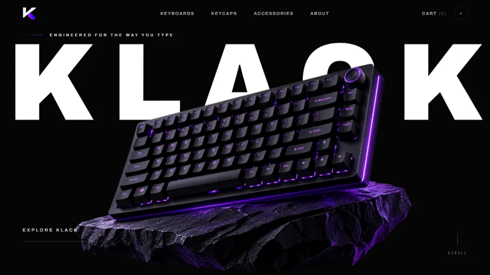
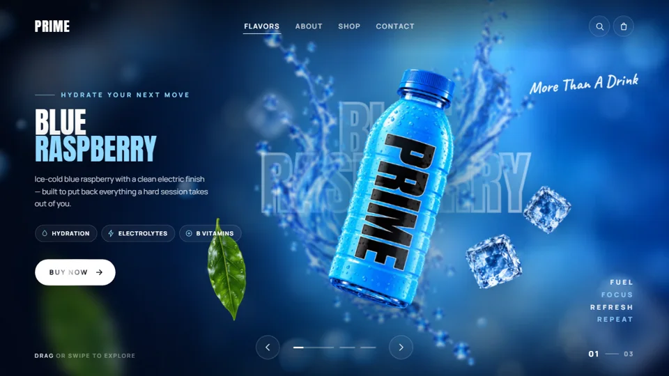

  

I’m a freelance developer and creative technologist. I build websites and mobile experiences, use AI to automate useful work and make video, and connect the finished product to digital marketing.

**What I work on:** web development · mobile apps · AI automation · AI video · digital marketing

## Selected work

### [Invito Bello →](https://github.com/suhailchalil/invito-bello-case-study)

A full-stack digital invitation product with interactive designs, a live personalisation studio, publishing, payments, and guest replies. I led the product design, frontend, backend, and motion work. The commercial source is private; the public repository is a visual and technical case study.

<table>
  <tr>
    <td width="50%" valign="top">
       
      <strong><a href="https://github.com/suhailchalil/klack">KLACK</a></strong> 
      An interactive mechanical keyboard storefront concept with layered motion, product storytelling, and responsive design. 
      <a href="https://suhailchalil.github.io/klack/">Live demo ↗</a> 
      HTML · CSS · JavaScript
    </td>
    <td width="50%" valign="top">
       
      <strong><a href="https://github.com/suhailchalil/prime-hydration">PRIME Hydration</a></strong> 
      A three-flavour campaign hero with swipe navigation, layered parallax, and both vanilla JavaScript and Next.js implementations. 
      <a href="https://suhailchalil.github.io/prime-hydration/">Live demo ↗</a> 
      Next.js · React · JavaScript
    </td>
  </tr>
  <tr>
    <td width="50%" valign="top">
       
      <strong><a href="https://github.com/suhailchalil/rose-eternelle">Rose Éternelle</a></strong> 
      A scroll-driven fragrance film that moves from video into a layered WebGL world and through a cloud transition. 
      <a href="https://suhailchalil.github.io/rose-eternelle/">Live demo ↗</a> 
      Three.js · WebGL · JavaScript
    </td>
    <td width="50%" valign="top">
      <strong>How I work</strong> 
      I care about the details people feel: clear hierarchy, mobile behaviour, fast loading, thoughtful motion, and a reliable path from an idea to a usable product.  
      <strong>Core tools</strong> 
      Next.js · React · TypeScript · CSS · GSAP · Three.js · Supabase · Git
    </td>
  </tr>
</table>

## Work with me

I’m available for freelance websites, mobile app interfaces, AI automation, AI video, and digital marketing projects.
